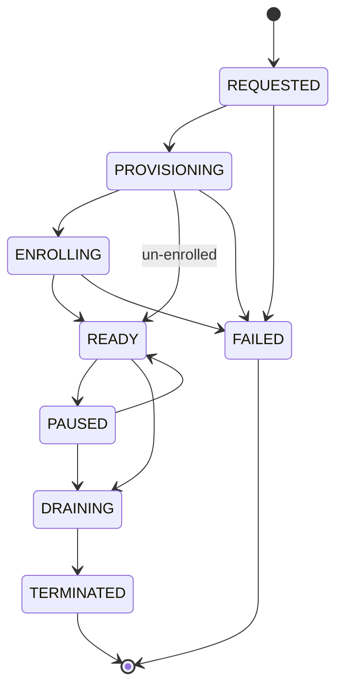
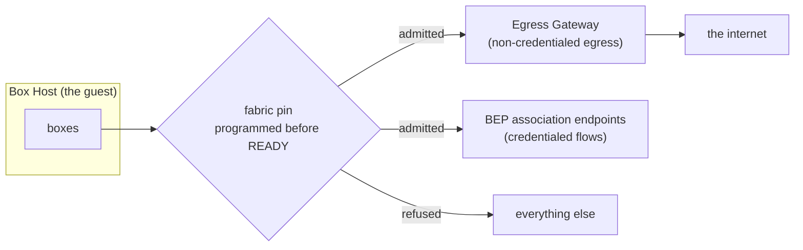

# BPA — Box Provider

> Product terms — Box Host, Box Provider, Egress Gateway, Box Egress Proxy — are defined in the [architecture glossary][glossary] and [acronyms.md][acronyms]. Requirements by ID: [requirements-index.md](requirements-index.md).

## Context

A Box Provider is the contract between a client and the Box Hosts it can reach. Neither the contract nor any provider exists. In the shipped client "provider" is a flag choosing between two local daemon backends — `minimald` on the host, or `minimald` in a microVM — which the client drives directly over that daemon's own SSH RPCs. There is no surface in between, so there is nothing a client could point at a machine it does not own.

This spec defines that surface. It states the contract as requirements, each naming an observable and the check that settles it, and it carries the gRPC and protobuf definition those requirements are written against. The architecture of record designs the contract and sketches the wire, deferring the field-level definition to the first implementation; this is that definition, taken from the sketch and kept compatible with it. What it adds beyond the sketch is folded back into that document at v0.12, so the two agree field for field rather than diverging from the day this one merged.

It also specifies the refactor that puts the client's local reach behind the surface, so that the three **well-known local providers** — `local-minvmd`, `local` and `local-box` — serve the API rather than being special cases beside it. Who serves them follows from what the daemons are. There is one minvmd per micro-VM and one minimald per native host, and nothing spans either set, so **`min` composes `local` and `local-minvmd` in-process**: it lists hosts by walking the per-host state directories, reads each host's record over that host's own socket, and for `local-minvmd` creates a host by starting a `minvmd run --detach --name <vm>` and deletes one by stopping it. minvmd and minimald are Box Hosts and host managers, never providers. **`local-box` is the one a daemon serves whole** — the parent minimald, over the socket projected into the box, since a nested `min` has no state directories to walk. The daemon RPCs behind the operations the API defines become provider-internal either way. What "provider" means in the source today, and what that refactor starts from, is inventoried in [existing-provider-surface.md](existing-provider-surface.md).

Building a remote provider is not part of this. The point of doing the local refactor against a real API is that the second provider — remote, third-party, or hosted — needs no change to the surface to arrive. Boxes themselves are the prerequisite: sessions and tasks become one box record under one grammar in a separate spec, and nothing here redefines them.

**Success:** every operation the Box Provider API defines — the inventory, a host's record, the lifecycle calls, the limits, and the metadata by which a client reaches a host — is performed by the client against a local Box Host through a well-known local provider — composed in-process for `local` and `local-minvmd`, served by the parent minimald for `local-box` — with no path that reaches a daemon's own RPCs directly to do one; the protobuf definition is complete enough to generate working client and server stubs; and a conformance suite written only from this document passes against each well-known local provider at the profile that provider declares and in the enrollment shape it runs — over a socket for `local-box` and a remote provider, through a harness linked into the client for the two the client composes.

Two client paths stay outside that condition by design, and neither is a failure of it: **creating and reaching a box**, which is direct to the Box Host and never through the provider ([non-goals](#non-goals); [Box Provider API §1][bpapi]), and **`min host stop`**, which manages a local daemon's own process rather than a provider-managed host ([§1][bpapi], v0.12).

**First slice:** one well-known local provider — `local`, static, served by minimald — serving the read surface over one binding: provider information, limits and usage, and the two host-read endpoints, paged, returning the error model's codes, and authenticated the way its un-enrolled default is — by the socket rather than by a token (BPA-094, BPA-095). The client reads its local hosts through that path instead of the daemon. No host creation, no watching, no lifecycle, and no second provider.

## Users and stories
**Roles:** developers who declare resource requirements for workloads that run away from their own machine, and developers who work with local and remote sessions in one session list.

- AS A developer who deploys demanding workflows in remote boxes, I WANT to specify the CPU and memory requirement of my box, SO THAT my workflow can successfully complete without being OOM killed or CPU starved.
- AS A developer running sessions both locally and remote, I WANT my remote hosts and the boxes on them to enumerate in the same listing as my local ones, SO THAT one `list` shows all my work wherever it runs. Reconnecting to a box is the box data path, which this surface is never in ([non-goals](#non-goals)); it belongs to the BOX and CLI specs in `gominimal/minimal`, and this spec's part is the inventory and the connection metadata those commands route on.

## Requirements

The requirements below state what must be true of a provider, each naming an observable and the check that settles it. The architecture of record ([Box Provider API][bpapi]) designs the contract they are written against and carries the review history behind it; where it settles a mechanism — the egress obligations are its §6.1, and the networking documents that section points at design what is behind them — the requirements cite it rather than restate it.

The normative wire definition is [`box-provider.proto`](https://github.com/gominimal/arch/blob/main/specs/box-provider/box-provider.proto), beside this file; each section below points at the messages it governs. Citations track the Box Provider API at **v0.12**, the version that folds back everything this spec needed and that document did not have: the added wire fields, with the proto named normative for names and numbers ([§7][bpapi]); the advertised bounds and watch resumption ([§6.2][bpapi]); the host state machine transition by transition, with what draining does to resident boxes ([§6.3][bpapi]); the two local carve-outs — the local socket in place of TLS, and the un-enrolled provider with no issuer to authenticate against ([§3][bpapi], [§4.2][bpapi]); the three error-model rows this spec's refusals need ([§8][bpapi]); and `min host stop`'s exclusion ([§1][bpapi]). Mostly owner rulings of 2026-10-22, recorded in that document's change history. Where that document marks a surface **[proposed]** — the host memory policy, and the CPU architecture it carries from the architecture's [Box Resources][boxresources] — so does this spec.

### Transport and reach

The service surface, taken from [§7][bpapi] with its RPC set and comments intact. Imports are stated rather than elided, since nothing can be generated without them.

- **BPA-013** THE SYSTEM SHALL present the Box Provider API from each well-known local provider — `local-minvmd`, `local` and `local-box` — with the same observable behaviour as a remote provider, whether the client composes it over per-host sockets or a daemon serves it whole.
  tier:     T0
  verify:   provider-conformance suite_passes_against_each_well_known_local_provider
  - THE SYSTEM SHALL serve `local-minvmd` at the dynamic profile, and `local` and `local-box` at the static profile.
    tier:   T0
    verify: provider-conformance well_known_local_provider_reports_its_profile
  - THE SYSTEM SHALL serve no well-known local provider at the multi-tenant profile.
    tier:   T0
    verify: provider-conformance no_well_known_local_provider_claims_multi_tenant
  - THE SYSTEM SHALL report every Box Host of a well-known local provider under a host name of its own, and SHALL carry no instance number in the provider's name.
    tier:   T0
    verify: provider-conformance host_instances_named_on_hosts_not_providers

- **BPA-040** WHERE a provider binds an endpoint of its own — a remote provider, or `local-box` served whole by the parent minimald — THE SYSTEM SHALL serve the API over at least one of the two defined wire bindings.
  tier:     T0
  verify:   provider-conformance endpoint_serves_at_least_one_binding
  - WHERE the client composes a provider in-process over per-host sockets, THE SYSTEM SHALL bind no endpoint of its own for that provider, and the socket rules bind each host socket it composes over.
    tier:   T0
    verify: provider-conformance composed_provider_binds_no_endpoint_of_its_own

- **BPA-042** WHERE a provider binds an endpoint of its own, THE SYSTEM SHALL return the same observable result for a request whichever wire binding carries it.
  tier:     T1
  verify:   provider-conformance bindings_produce_identical_results
  property: for every request the API defines, the observable result is identical whether the gRPC binding or the Connect binding carries it

- **BPA-043** WHERE a provider is reachable over a network transport, THE SYSTEM SHALL serve every endpoint over TLS.
  tier:     T0
  verify:   provider-conformance every_network_endpoint_served_over_tls
  - WHERE a provider is reachable only over a local socket, THE SYSTEM SHALL restrict that socket to the user the provider serves.
    tier:   T0
    verify: provider-conformance local_socket_restricted_to_its_user

- **BPA-044** THE SYSTEM SHALL expose no endpoint that streams in both directions.
  tier:     T0
  verify:   provider-conformance no_bidirectional_streaming

### Enrollment, and the un-enrolled local case

Two of the six deployment styles run their Box Hosts **un-enrolled by default**: LocalVM and SharedLinux are each "un-enrolled (degraded), or client-mediated · `local`" in the architecture's [Deployment Styles][deploystyles] table, and those two styles are exactly where the well-known local providers serve — `local-minvmd` on the first, `local` and `local-box` on the second. An un-enrolled Box Host holds no Gatehouse identity of any kind: no host certificate, no node identity, no tenant-zone DNS name, and no gateway assignment. In its record `tenant`, `node_id` and `created_by` are empty, as is `gateway_id` where no Egress Gateway is assigned; `egress_pin` is still reported honestly, which BPA-034 already binds — `pinned` on LocalVM, where gvproxy enforces outside the guest, `advisory` or `none` on SharedLinux. It has no tenancy for BPA-020 and BPA-022 to bind, which is why both name enrollment, and the single caller the socket admits is the scope `Quotas` and `Usage` report against ([Box Provider API §4.3][bpapi]). What stands in for all of it is the socket — "transport access control is then the UDS file mode and Gatehouse provides nothing" ([Gatehouse §6.2][gatehouse], F16), which the API carries as the second exception to its every-call verification rule ([§4.2][bpapi], v0.12). The near-term shape of such a host is the networking design's degraded-mode profile ([§7.1][netdesign], **[proposed]**), which is where its local `*.min.internal` names come from.

This is not a gap for this spec to close by requiring enrollment: the un-enrolled local path is the architecture's escape hatch for a developer with no Gatehouse, and narrowing BPA-013 to enrolled hosts would exempt the commonest developer setup from the API that BPA-013 exists to put it behind. So the five requirements that depend on an identity plane — BPA-023, BPA-074, BPA-076, BPA-077 and BPA-079 — are scoped to hosts that have one, each saying what holds in its place; BPA-073 already was. The two requirements here state what a caller gets instead.

- **BPA-094** WHERE a provider's Box Hosts are un-enrolled, THE SYSTEM SHALL serve the API over a local socket only, and over no network transport.
  tier:     T0
  verify:   provider-conformance unenrolled_provider_serves_no_network_transport

- **BPA-095** WHERE a provider's Box Hosts are un-enrolled, THE SYSTEM SHALL take the access control on that socket as the whole of its authentication, and SHALL accept no credential of its own making in place of a Gatehouse one.
  tier:     T0
  verify:   provider-conformance unenrolled_provider_authenticates_by_socket_alone
  - THE SYSTEM SHALL require no access token on a call it serves un-enrolled.
    tier:   T0
    verify: provider-conformance unenrolled_provider_requires_no_token

### Authentication, on every call

These apply to a provider whose Box Hosts are enrolled; un-enrolled there is no issuer to verify a token against, which is [§4.2][bpapi]'s second exception since v0.12, and BPA-094 and BPA-095 state the boundary that holds instead. Only BPA-045 carries that clause: BPA-046 to BPA-050 are each conditional on a token being presented, and a provider configured for no issuer refuses every token that arrives by BPA-047.

They apply to every endpoint except the public discovery subset of the provider-information call, which the architecture leaves open to a caller presenting no credential so that version negotiation works for a client too old to authenticate (§4.2, §7). Which scope verb each of the others takes is [§4.1][bpapi]'s recommended mapping over a tenant-defined grammar, not restated here; BPA-050 binds a provider to whatever scope its endpoints do require.

- **BPA-045** WHERE a provider's Box Hosts are enrolled and a call is not a request for the public discovery subset of provider information, THE SYSTEM SHALL verify that call's access token and proof of possession before executing it.
  tier:     T0
  verify:   provider-conformance verification_precedes_execution
  - WHEN an unauthenticated caller requests provider information THE SYSTEM SHALL return the protocol versions, the minimum client version, the conformance profile and the wire bindings served, and no other field.
    tier:   T0
    verify: provider-conformance unauthenticated_discovery_returns_public_subset_only

- **BPA-046** WHERE a call carries a token, IF that token's audience is not this provider THEN THE SYSTEM SHALL refuse the call.
  tier:     T0
  verify:   provider-conformance wrong_audience_token_refused

- **BPA-047** WHERE a call carries a token, IF that token is from an issuer the provider is not configured for THEN THE SYSTEM SHALL refuse the call.
  tier:     T0
  verify:   provider-conformance unconfigured_issuer_token_refused

- **BPA-048** WHERE a call is not a request for the public discovery subset of provider information, IF it presents a token without a proof of possession THEN THE SYSTEM SHALL refuse the call.
  tier:     T0
  verify:   provider-conformance token_without_proof_refused

- **BPA-049** IF a call presents a proof of possession the provider has already seen THEN THE SYSTEM SHALL refuse the call.
  tier:     T0
  verify:   provider-conformance replayed_proof_refused

- **BPA-050** IF a call presents a token lacking the scope its endpoint requires THEN THE SYSTEM SHALL refuse the call.
  tier:     T0
  verify:   provider-conformance insufficient_scope_refused

### What a provider advertises

The messages: `ProviderInfo`, `GatewayInfo`, `BepInfo` in [`box-provider.proto`](https://github.com/gominimal/arch/blob/main/specs/box-provider/box-provider.proto). The bounds BPA-062, BPA-091 and BPA-092 report are [§6.2][bpapi].

- **BPA-001** WHEN a caller requests provider information THE SYSTEM SHALL report the conformance profile the provider implements.
  tier:     T0
  verify:   provider-conformance provider_info_reports_profile

- **BPA-002** WHEN a caller requests provider information THE SYSTEM SHALL report every optional capability the provider supports.
  tier:     T0
  verify:   provider-conformance provider_info_reports_capabilities

- **BPA-041** WHEN a caller requests provider information THE SYSTEM SHALL report every wire binding the provider serves.
  tier:     T0
  verify:   provider-conformance provider_info_reports_bindings

- **BPA-007** WHEN a caller requests provider information THE SYSTEM SHALL report whether the provider's set of Box Hosts is fixed or can be created on demand.
  tier:     T0
  verify:   provider-conformance provider_info_reports_fixed_or_on_demand

- **BPA-008** WHEN a caller requests provider information THE SYSTEM SHALL report every protocol version the provider speaks.
  tier:     T0
  verify:   provider-conformance provider_info_reports_interface_versions

- **BPA-009** WHEN a caller requests provider information THE SYSTEM SHALL report the oldest client version the provider supports.
  tier:     T0
  verify:   provider-conformance provider_info_reports_oldest_client

- **BPA-062** WHEN a caller requests provider information THE SYSTEM SHALL report the provider's maximum page size.
  tier:     T0
  verify:   provider-conformance provider_info_reports_max_page_size

- **BPA-091** WHERE a provider creates Box Hosts on demand, WHEN a caller requests provider information THE SYSTEM SHALL report the largest Box Host that provider will create, in each resource dimension.
  tier:     T0
  verify:   provider-conformance provider_info_reports_max_host_size

- **BPA-092** WHERE a provider creates Box Hosts on demand, WHEN a caller requests provider information THE SYSTEM SHALL report how long that provider honours an idempotency key.
  tier:     T0
  verify:   provider-conformance provider_info_reports_idempotency_window

- **BPA-003** THE SYSTEM SHALL advertise only capabilities the provider performs end to end.
  tier:     T1
  verify:   provider-conformance advertised_capabilities_all_perform
  property: for every capability in a provider's advertised set, invoking that capability completes rather than reporting it unimplemented
  - THE SYSTEM SHALL advertise no capability whose name the Box Provider API reserves before that API defines the metadata a caller needs to act on it.
    tier:   T0
    verify: provider-conformance reserved_capability_not_advertised

- **BPA-004** IF a caller invokes a capability the provider does not advertise THEN THE SYSTEM SHALL refuse the call and name the capability in the error.
  tier:     T1
  verify:   provider-conformance unadvertised_capability_refused_by_name
  property: for every capability outside a provider's advertised set, invoking it is refused and the refusal names that capability

### Idempotency

- **BPA-051** THE SYSTEM SHALL accept a caller-set idempotency key on every lifecycle call.
  tier:     T0
  verify:   provider-conformance lifecycle_accepts_idempotency_key

- **BPA-052** WHEN a lifecycle call repeats an idempotency key with the payload that key was first used with THE SYSTEM SHALL return the result of the first call.
  tier:     T0
  verify:   provider-conformance replayed_key_returns_first_result
  - THE SYSTEM SHALL honour an idempotency key for at least as long as the window it reports.
    tier:   T0
    verify: provider-conformance key_honoured_for_advertised_window

- **BPA-053** WHEN a lifecycle call repeats an idempotency key with the payload that key was first used with THE SYSTEM SHALL create nothing further.
  tier:     T0
  verify:   provider-conformance replayed_key_creates_nothing

- **BPA-054** IF a lifecycle call repeats an idempotency key with a payload different from the one that key was first used with THEN THE SYSTEM SHALL refuse the call.
  tier:     T0
  verify:   provider-conformance reused_key_changed_payload_refused

### The host inventory

The messages: `ListHostsRequest`, `ListHostsResponse`, `GetHostRequest` and `Resources` in [`box-provider.proto`](https://github.com/gominimal/arch/blob/main/specs/box-provider/box-provider.proto).

- **BPA-005** WHEN a caller reads the inventory of Box Hosts to its end THE SYSTEM SHALL have reported every Box Host the caller's tenant holds on that provider.
  tier:     T0
  verify:   provider-conformance host_inventory_complete
  - THE SYSTEM SHALL report, for each Box Host, its allocatable CPU in millicores, its allocatable memory in bytes and its allocatable disk in bytes.
    tier:   T0
    verify: provider-conformance host_inventory_reports_resources
  - THE SYSTEM SHALL report, for each Box Host, the CPU architecture that host runs (**[proposed]**).
    tier:   T0
    verify: provider-conformance host_inventory_reports_cpu_arch
  - THE SYSTEM SHALL report, for each Box Host, the Egress Gateway it is assigned to where it has one, and its egress-pin state.
    tier:   T0
    verify: provider-conformance host_inventory_reports_gateway_and_pin
  - THE SYSTEM SHALL report a Box Host's allocatable figure as that host's capacity less the host's own reserve, so the reserve is outside what its boxes can be given.
    tier:   T0
    verify: provider-conformance allocatable_excludes_host_reserve
  - THE SYSTEM SHALL report a Box Host's allocated figure, in every resource dimension, as the sum of its live boxes' reservations rather than of their limits.
    tier:   T0
    verify: provider-conformance allocated_sums_reservations_not_limits

- **BPA-055** WHEN a caller makes a listing call THE SYSTEM SHALL return at most one page of results.
  tier:     T0
  verify:   provider-conformance listing_returns_one_page

- **BPA-056** WHEN a listing call leaves results unreturned THE SYSTEM SHALL return a cursor with that page.
  tier:     T0
  verify:   provider-conformance listing_returns_cursor_when_more_remain

- **BPA-057** THE SYSTEM SHALL accept a cursor only in the form it issued it.
  tier:     T0
  verify:   provider-conformance modified_cursor_refused

- **BPA-058** WHEN a caller passes back a cursor THE SYSTEM SHALL continue the listing after the last result already returned.
  tier:     T0
  verify:   provider-conformance cursor_continues_after_last_result

- **BPA-059** WHEN a caller narrows a listing call by host state, host class or labels THE SYSTEM SHALL return only hosts matching those filters.
  tier:     T0
  verify:   provider-conformance listing_filters_by_state_class_labels

- **BPA-060** WHEN a caller states a page size THE SYSTEM SHALL return no more results than that number.
  tier:     T0
  verify:   provider-conformance page_size_request_honoured_as_ceiling

- **BPA-061** THE SYSTEM SHALL return no more results in a page than the provider's own maximum page size.
  tier:     T0
  verify:   provider-conformance page_never_exceeds_provider_maximum

### The host record

The message: `Host`, with `SshEndpoint`, in [`box-provider.proto`](https://github.com/gominimal/arch/blob/main/specs/box-provider/box-provider.proto).

- **BPA-073** WHILE a Box Host is enrolled THE SYSTEM SHALL report the node identity it enrolled with in that host's record.
  tier:     T0
  verify:   provider-conformance host_record_reports_node_identity

- **BPA-074** WHERE a Box Host is enrolled, THE SYSTEM SHALL report, in that host's record, an SSH endpoint and the DNS name the provider publishes for that host.
  tier:     T0
  verify:   provider-conformance host_record_reports_endpoint_and_dns
  - WHERE a Box Host is un-enrolled, THE SYSTEM SHALL report that host's local endpoint as `unix:<path>` with port 0, the local-zone name where its deployment answers one, and no tenant-zone name (**[proposed]**).
    tier:   T0
    verify: provider-conformance unenrolled_host_record_reports_local_endpoint_and_no_tenant_name

- **BPA-075** THE SYSTEM SHALL use no Box Host label as an input to an authorization decision.
  tier:     T0
  verify:   provider-conformance label_never_authorization_input

### The host's memory policy

The memory rules themselves are stated once, in the architecture of record's [Box Resources][boxresources] (**[proposed]**), and the fields a host reports are its [`MemoryPolicy`][bpapi] in Box Provider API §6 (v0.11, **[proposed]**). The requirements below state only what a provider must report and how honestly — they set no threshold and define no guarantee. The three memory guarantees referred to are that document's: each box's limit, hard reservations, and the cap on a host's boxes together that keeps the host's own reserve out of their reach. Memory is the only dimension where a reservation can sit below a limit, which is why it alone needs a policy reported; a box's CPU and disk reservations are the values it declares, so BPA-005 and BPA-090 count them without any further rule. Whether a host enforces a CPU or disk limit the way it enforces memory is the Box Host's, and open upstream.

The message: `MemoryPolicy`, and `Host.memory` that carries it, in [`box-provider.proto`](https://github.com/gominimal/arch/blob/main/specs/box-provider/box-provider.proto).

- **BPA-084** THE SYSTEM SHALL report, in each Box Host's record, the default box memory size that host resolves an unstated requirement to.
  tier:     T0
  verify:   provider-conformance host_record_reports_default_box_ram
  - THE SYSTEM SHALL report no default box memory size above that host's allocatable memory.
    tier:   T0
    verify: provider-conformance default_box_ram_within_allocatable

- **BPA-085** THE SYSTEM SHALL report, in each Box Host's record, whether that host overcommits memory, and where it does, the reservation an omitted requirement resolves to.
  tier:     T0
  verify:   provider-conformance host_record_reports_overcommit_and_floor

- **BPA-086** THE SYSTEM SHALL report, in each Box Host's record, that host's memory enforcement as either enforced or advisory.
  tier:     T0
  verify:   provider-conformance host_record_reports_memory_enforcement

- **BPA-087** THE SYSTEM SHALL report a Box Host's memory enforcement as the enforcement that host's platform delivers rather than the enforcement it is configured for.
  tier:     T0
  verify:   provider-conformance memory_enforcement_reported_honestly
  - IF a Box Host does not deliver all three memory guarantees THEN THE SYSTEM SHALL report that host's memory enforcement as advisory.
    tier:   T0
    verify: provider-conformance partial_memory_guarantees_reported_advisory

- **BPA-088** WHERE a Box Host's memory enforcement is advisory, THE SYSTEM SHALL report that host's allocatable and allocated memory, and count its boxes' reservations toward the caller's consumption, as it does for a host whose enforcement is enforced.
  tier:     T0
  verify:   provider-conformance advisory_host_accounted_like_enforced

### Host state and lifecycle

The states BPA-014 and BPA-071 bind. `P1` providers surface only `READY` and `TERMINATED`, plus `PAUSED` where capable.

**`DRAINING` is cleanup**: the resource release and bookkeeping a host needs before it can terminate, not a wait for resident work to finish. That and the two transitions §6's arrow left to inference are [§6.3][bpapi]'s since v0.12, folded back from this spec's review rather than recorded here — what follows is why they read as they do. A paused host drains and terminates without being resumed first, because the cleanup it needs does not depend on anything running. And an ephemeral host auto-terminating after its first box (BPA-072) drains on the way, so "terminate" there names the outcome rather than a transition that skips cleanup.

**Draining ends a resident box; it does not wait on one.** "Not a wait for resident work" is not licence to drop boxes mid-flight. A draining host ends each running box the way a stop ends it — SIGTERM, the daemon's grace period, then SIGKILL — which is what `min host stop` already does to each running box, so BPA-070's draining is bounded by that grace period rather than by what a resident agent or task was doing (architecture, the box record; [§6.3][bpapi]). The two halves are separable and both needed: a host that waited for resident work could drain for hours, and one that killed without the grace period would end every box with no recorded end.

**`ENROLLING` is skipped where there is nothing to enroll.** An un-enrolled Box Host (BPA-094) has no identity to acquire, so its bring-up runs `PROVISIONING → READY` and the diagram carries that edge — a third transition §6's arrow did not draw, and [§6.3][bpapi]'s since v0.12. BPA-071 binds the order of the states a host does report, not that every state occur: a provider skipping a state it has no work for conforms, and one reporting `ENROLLING` for a host that enrolls nothing does not.

**`FAILED` stays pre-`READY` only**, which [§6][bpapi] has said since v0.7 and [§6.3][bpapi] now carries with its consequence. It marks a host that never entered service, and its two triggers are both provisioning-time: a required pin failing on a pin-capable platform, and a first-heartbeat mismatch — the second only where the host enrolls, since it compares against a registration (BPA-077). A host that breaks after `READY` leaves service the way any host does, by draining and terminating — which tells a caller more than a second terminal state would, since it says the host is going away rather than merely unusable. Nothing here requires a provider to notice: that a provider has established a host is dead is not observable to a conformance suite, and BPA-015 already accepts that a host whose death has not been noticed still reports `READY`.

The states and the lifecycle messages: `HostState`, `CreateHostRequest`, and the delete, pause and resume requests in [`box-provider.proto`](https://github.com/gominimal/arch/blob/main/specs/box-provider/box-provider.proto).

- **BPA-014** THE SYSTEM SHALL report every Box Host's state as one of the states defined by the Box Provider API host state machine.
  tier:     T0
  verify:   provider-conformance host_state_within_defined_set

- **BPA-015** WHILE a ready Box Host is unreachable by a caller THE SYSTEM SHALL continue to report that host as ready.
  tier:     T0
  verify:   provider-conformance ready_state_unchanged_by_unreachability

- **BPA-069** WHEN a caller creates a Box Host THE SYSTEM SHALL return that host in a state preceding readiness.
  tier:     T0
  verify:   provider-conformance create_returns_pre_ready_state

- **BPA-070** WHEN a caller deletes a Box Host THE SYSTEM SHALL place that host into draining rather than removing it immediately.
  tier:     T0
  verify:   provider-conformance delete_begins_draining
  - WHILE a Box Host is draining THE SYSTEM SHALL end each box resident on that host as a stop ends it, so that each box ends with a recorded end.
    tier:   T0
    verify: provider-conformance draining_ends_resident_boxes_as_a_stop_does
  - THE SYSTEM SHALL wait, while draining, for no resident box's own work to reach an end.
    tier:   T0
    verify: provider-conformance draining_waits_for_no_resident_work

  Settled by the owner review: a delete is never refused by the provider for having running boxes. The confirmation is the client's — `min host rm` prompts on a TTY and takes `--force` or `--yes` off one, as `min box rm` does — so there is no `force` field on the wire and a delete stays one call. A caller that is not `min` and skips the confirmation has made its own choice. The prompt itself belongs to the CLI spec in `gominimal/minimal`.

- **BPA-071** THE SYSTEM SHALL report a Box Host's states in the order the host state machine defines.
  tier:     T0
  verify:   provider-conformance states_follow_transition_order

- **BPA-072** WHERE a Box Host is created as one-time-use, WHEN its first box completes THE SYSTEM SHALL terminate that host.
  tier:     T0
  verify:   provider-conformance one_time_use_host_terminates_after_first_box

### Watching for changes

The messages: `WatchHostsRequest` and `HostEvent` in [`box-provider.proto`](https://github.com/gominimal/arch/blob/main/specs/box-provider/box-provider.proto). The stream starts from now and retains nothing: resumption is deferred past v1, so there is no sequence number, no resume point and no history window ([§6.2][bpapi]). A client that needs certainty polls the host-read endpoints, which is the v1 contract.

- **BPA-063** WHERE a provider advertises the watch capability, THE SYSTEM SHALL emit each Box Host state transition exactly once on the watch stream.
  tier:     T0
  verify:   provider-conformance transition_emitted_exactly_once

- **BPA-064** WHERE a provider advertises the watch capability, THE SYSTEM SHALL carry, on each watch event, the Box Host the transition concerns.
  tier:     T0
  verify:   provider-conformance watch_event_carries_its_host

### Errors and refusals

BPA-066 binds a provider to the codes [§8][bpapi] assigns rather than restating them. Two of those rows exist because of requirements here and were folded back at v0.12: the invalid-argument refusal of a cursor the provider did not issue in that form (BPA-057), and the rule that on a multi-tenant provider an unknown host identifier is permission-denied (BPA-080) — which is the one condition whose exit code turns on the profile.

- **BPA-066** THE SYSTEM SHALL return, for each failure condition, the code the error model assigns that condition.
  tier:     T0
  verify:   provider-conformance failure_returns_mapped_code

- **BPA-067** THE SYSTEM SHALL carry with each failure the structured detail its condition names.
  tier:     T0
  verify:   provider-conformance failure_carries_structured_detail

- **BPA-089** WHERE a provider creates Box Hosts on demand, THE SYSTEM SHALL distinguish a refusal because no Box Host it can create would satisfy the request from a refusal because a caller's limit is exceeded, by the structured detail each carries.
  tier:     T0
  verify:   provider-conformance sizing_refusal_distinct_from_quota_refusal
  - WHEN a request is refused because it would exceed a caller's limit THE SYSTEM SHALL carry the quota detail the error model assigns, and never the insufficient-resources detail the error model assigns a Box Host's own refusal.
    tier:   T0
    verify: provider-conformance quota_refusal_carries_quota_detail

- **BPA-080** WHERE a provider serves more than one tenant, IF a caller names a Box Host identifier matching no Box Host THEN THE SYSTEM SHALL refuse with the permission-denied code rather than the not-found code.
  tier:     T0
  verify:   provider-conformance unknown_host_id_refused_as_permission_denied

- **BPA-068** THE SYSTEM SHALL take no different time to refuse a Box Host identifier belonging to another tenant than one matching no Box Host.
  tier:     T0
  verify:   provider-conformance no_timing_correlation_with_host_existence
  - THE SYSTEM SHALL decide that refusal without consulting whether the named Box Host exists.
    tier:   T0
    verify: provider-conformance cross_tenant_refusal_consults_no_existence

### Reconciling a declared requirement

- **BPA-010** WHERE a provider creates Box Hosts on demand, WHEN a caller requests a Box Host whose declared resource requirements exceed the provider's allocatable capacity THE SYSTEM SHALL leave the caller's host inventory unchanged.
  tier:     T0
  verify:   provider-conformance oversized_request_leaves_inventory_unchanged

- **BPA-093** WHERE a provider creates Box Hosts on demand, WHEN a create call states a CPU architecture THE SYSTEM SHALL create a Box Host of that architecture or refuse the call, and SHALL never substitute another (**[proposed]**).
  tier:     T0
  verify:   provider-conformance requested_cpu_arch_never_substituted

- **BPA-011** WHERE a provider creates Box Hosts on demand, IF no Box Host it can create would meet a declared resource requirement THEN THE SYSTEM SHALL fail the request and name the unmet dimension.
  tier:     T0
  verify:   provider-conformance unsatisfiable_request_names_unmet_dimension

- **BPA-012** WHERE a provider creates Box Hosts on demand, IF no Box Host it can create would meet a declared resource requirement THEN THE SYSTEM SHALL fail that request finally, so that the same request produces no Box Host without being made again.
  tier:     T0
  verify:   provider-conformance unsatisfiable_request_is_final_not_queued

### Limits

The messages: `Quotas`, `QuotaLimit`, `Usage` and `UsageValue` in [`box-provider.proto`](https://github.com/gominimal/arch/blob/main/specs/box-provider/box-provider.proto).

- **BPA-016** WHEN a caller requests its effective limits THE SYSTEM SHALL report the limits in force for that caller.
  tier:     T0
  verify:   provider-conformance limits_reported_on_request

- **BPA-017** WHEN a caller requests its current consumption THE SYSTEM SHALL report that caller's current consumption.
  tier:     T0
  verify:   provider-conformance usage_reported_on_request

- **BPA-018** THE SYSTEM SHALL enforce a caller's host-level limits whether or not the caller has requested them.
  tier:     T0
  verify:   provider-conformance limits_enforced_without_introspection

- **BPA-019** IF a request would exceed one of the caller's limits THEN THE SYSTEM SHALL refuse the request and name the exceeded dimension, its limit and the current usage.
  tier:     T0
  verify:   provider-conformance over_limit_request_names_dimension

- **BPA-039** WHERE two requests that each fit within a caller's remaining limit would together exceed it, THE SYSTEM SHALL admit at most one of them.
  tier:     T0
  verify:   provider-conformance concurrent_requests_never_exceed_limit_together

- **BPA-090** THE SYSTEM SHALL count, in every resource dimension of a caller's consumption, the reservations of that caller's live boxes rather than their limits.
  tier:     T0
  verify:   provider-conformance usage_counts_reservations_not_limits

- **BPA-027** THE SYSTEM SHALL deliver to each of its Box Hosts the box-level quota configuration in force for that host's tenant.
  tier:     T0
  verify:   provider-conformance box_quota_config_delivered_to_hosts

- **BPA-028** WHERE a provider serves more than one tenant THE SYSTEM SHALL apply a rate limit to each tenant separately.
  tier:     T0
  verify:   provider-conformance rate_limits_applied_per_tenant

- **BPA-029** WHERE a provider creates Box Hosts on demand, IF it cannot determine the caller's current consumption THEN THE SYSTEM SHALL refuse to create a Box Host.
  tier:     T0
  verify:   provider-conformance create_fails_closed_when_usage_unknown

### Tenancy

- **BPA-020** WHERE a Box Host is enrolled, THE SYSTEM SHALL assign that host to exactly one tenant at any time.
  tier:     T0
  verify:   provider-conformance host_owned_by_one_tenant
  - WHEN a Box Host that has served one tenant appears in a second tenant's inventory THE SYSTEM SHALL present it holding no data written under the first tenant.
    tier:   T0
    verify: provider-conformance reassigned_host_carries_no_prior_tenant_data
  - WHEN a Box Host that has served one tenant appears in a second tenant's inventory THE SYSTEM SHALL present it holding no identity it held in the first tenant's trust domain.
    tier:   T0
    verify: provider-conformance reassigned_host_carries_no_prior_tenant_identity

- **BPA-021** IF a call would return, modify or place load on a Box Host owned by a tenant other than the caller's THEN THE SYSTEM SHALL refuse the call.
  tier:     T0
  verify:   provider-conformance cross_tenant_call_refused
  - WHERE a provider serves more than one tenant, IF a caller names a Box Host belonging to another tenant THEN THE SYSTEM SHALL refuse with the permission-denied code the error model assigns, in the same shape it uses for a Box Host that does not exist.
    tier:   T0
    verify: provider-conformance cross_tenant_refusal_does_not_disclose_existence

- **BPA-022** WHERE a Box Host is enrolled, THE SYSTEM SHALL report that host in the inventory of at most one tenant at a time.
  tier:     T0
  verify:   provider-conformance host_appears_in_one_tenant_inventory

### Credentials and the enrollment hand-off

- **BPA-023** WHERE a Box Host is enrolled, WHEN a caller requests that host's connection metadata THE SYSTEM SHALL return an endpoint at which the Box Host presents its own host certificate.
  tier:     T0
  verify:   provider-conformance returned_endpoint_terminates_at_host
  - THE SYSTEM SHALL return an endpoint whose Box Host a caller can authenticate against the identity plane's host certificate alone, carrying nothing a caller would have to trust the provider for.
    tier:   T0
    verify: provider-conformance returned_endpoint_verifiable_without_trusting_provider
  - WHERE a Box Host is un-enrolled, THE SYSTEM SHALL return an endpoint reachable only over a local socket whose access control is the authentication — `unix:<path>` in the endpoint's address with its port 0 — and SHALL offer no key or certificate for a caller to trust on first use.
    tier:   T0
    verify: provider-conformance unenrolled_endpoint_is_socket_and_offers_no_tofu_key
  - THE SYSTEM SHALL report, for any Box Host it reports as ready, enrolled or not, connection metadata sufficient to reach that host without a further call.
    tier:   T0
    verify: provider-conformance connection_metadata_sufficient_to_connect

- **BPA-024** THE SYSTEM SHALL store no tenant credential other than, for one Box Host, a single-purpose enrollment token and a bootstrap-only candidate WireGuard private key, and SHALL request none.
  tier:     T0
  verify:   provider-conformance provider_stores_no_standing_tenant_credential
  - THE SYSTEM SHALL hold an enrollment token and a candidate WireGuard private key encrypted at rest, and SHALL delete each when it is redeemed, when its token's lifetime elapses, or, where no token was minted, when the registration's lifetime elapses — whichever comes first.
    tier:   T0
    verify: provider-conformance bootstrap_credentials_deleted_on_redemption_or_expiry
  - THE SYSTEM SHALL deliver an enrollment token and a candidate WireGuard private key to a Box Host through that host's boot context and by no other means.
    tier:   T0
    verify: provider-conformance bootstrap_credentials_delivered_by_boot_context_only
  - THE SYSTEM SHALL write no enrollment token and no candidate WireGuard private key to a log.
    tier:   T0
    verify: provider-conformance bootstrap_credentials_never_logged

- **BPA-076** WHERE a provider enrolls the Box Hosts it creates, THE SYSTEM SHALL accept on a create call the node identity and gateway assignment the caller pre-registered for that Box Host, and the private half of the candidate WireGuard key whose public half it registered.
  tier:     T0
  verify:   provider-conformance create_accepts_preregistered_node_gateway_and_key
  - WHERE a provider does not enroll Box Hosts by attestation, THE SYSTEM SHALL additionally accept the enrollment token minted for that node identity.
    tier:   T0
    verify: provider-conformance create_accepts_enrollment_token_absent_attestation
  - WHERE a provider creates un-enrolled Box Hosts, THE SYSTEM SHALL require none of those inputs on a create call.
    tier:   T0
    verify: provider-conformance unenrolled_create_requires_no_enrollment_inputs

- **BPA-077** WHERE a provider enrolls the Box Hosts it creates, IF a Box Host's first heartbeat reports a class or node identity different from the one its create request stated THEN THE SYSTEM SHALL mark that host failed.
  tier:     T0
  verify:   provider-conformance heartbeat_mismatch_marks_host_failed

### The egress fabric

What a confined Box Host may reach is its **infrastructure set**: the Egress Gateway it is assigned to, and the Box Egress Proxy association endpoints assigned to it ([Box Provider API §6.1][bpapi]; networking design §4.4 and §5.6). The set is static per host — it is not widened or narrowed per box — and the requirements below say "confined to its infrastructure set" throughout rather than naming the gateway alone, because a host confined to the gateway alone has no credentialed path.

Two of the requirements below are scoped to **association variants** — the deployments in which a host reaches its Box Egress Proxy over an association rather than over a helper on its own outer host OS. Where a host's Box Egress Proxy is node-local, the host holds no association, and its infrastructure set is the host-side helper reached over the machine-internal link ([Box Provider API §6.1][bpapi], v0.10; networking design §7.6). Which deployments those are is the architecture's [Deployment Styles][deploystyles] taxonomy, not this spec's to enumerate.

- **BPA-078** WHEN a caller requests provider information THE SYSTEM SHALL report every Egress Gateway the provider offers, each with the identifier a caller names it by.
  tier:     T0
  verify:   provider-conformance provider_info_reports_gateways

- **BPA-081** WHEN a caller requests provider information THE SYSTEM SHALL report every Box Egress Proxy association endpoint set the provider offers, each with the identifier a caller names it by and the endpoint addresses a host reaches it at.
  tier:     T0
  verify:   provider-conformance provider_info_reports_beps
  - THE SYSTEM SHALL report nothing node-facing in an association endpoint set — no association key, no association-plane address and no rotation state.
    tier:   T0
    verify: provider-conformance bep_discovery_carries_no_node_facing_identity

- **BPA-031** WHERE a Box Host runs on a platform that can confine its egress, THE SYSTEM SHALL report that host as ready only once it is confined to its infrastructure set.
  tier:     T0
  verify:   provider-conformance ready_implies_egress_confined
  - IF confining a Box Host to its infrastructure set does not succeed on a platform that can confine egress THEN THE SYSTEM SHALL report that host as failed.
    tier:   T0
    verify: provider-conformance failed_pin_marks_host_failed

- **BPA-082** WHERE a Box Host reaches its Box Egress Proxy over an association, THE SYSTEM SHALL confine that host to every endpoint of the association endpoint set assigned to it, so that a host reported ready has a complete credentialed path.
  tier:     T0
  verify:   provider-conformance pin_covers_complete_assigned_bep_endpoint_set

- **BPA-032** WHERE a Box Host runs on a platform that can confine its egress, THE SYSTEM SHALL confine that host on every address family the host can reach the network by.
  tier:     T0
  verify:   provider-conformance egress_confined_on_every_address_family

- **BPA-033** THE SYSTEM SHALL change a Box Host's egress confinement for no reason but a change to the infrastructure set that host is confined to.
  tier:     T0
  verify:   provider-conformance egress_confinement_never_reprogrammed
  - IF a box declares egress its Box Host's confinement does not already permit THEN THE SYSTEM SHALL leave that confinement unchanged.
    tier:   T0
    verify: provider-conformance box_egress_never_widens_host_confinement

- **BPA-083** WHEN the infrastructure set a Box Host is confined to changes THE SYSTEM SHALL admit the incoming endpoints before withdrawing the outgoing ones.
  tier:     T0
  verify:   provider-conformance endpoint_rotation_adds_before_retiring

- **BPA-034** THE SYSTEM SHALL report each Box Host's egress-pin state as the state that host's platform enforces for it.
  tier:     T0
  verify:   provider-conformance egress_pin_reported_honestly
  - IF a Box Host's confinement admits any destination outside that host's infrastructure set THEN THE SYSTEM SHALL report that host's egress-pin state as site-widened rather than pinned.
    tier:   T0
    verify: provider-conformance widened_confinement_reported_as_site_widened
  - IF a Box Host's platform cannot confine its egress THEN THE SYSTEM SHALL report that host's egress-pin state as advisory or as absent, and never as pinned.
    tier:   T0
    verify: provider-conformance unconfinable_platform_never_reported_pinned

- **BPA-035** THE SYSTEM SHALL leave a Box Host holding no credential of the provider's own infrastructure.
  tier:     T0
  verify:   provider-conformance host_holds_no_provider_infrastructure_credential

- **BPA-036** THE SYSTEM SHALL make no change to an Egress Gateway's policy.
  tier:     T0
  verify:   provider-conformance provider_never_writes_egress_gateway_policy

- **BPA-037** WHERE a provider supplies the image of a Box Host that reaches its Box Egress Proxy over an association, THE SYSTEM SHALL supply in that image what the host needs to establish that association.
  tier:     T0
  verify:   provider-conformance host_image_can_establish_association

- **BPA-038** THE SYSTEM SHALL carry its own channel to a Box Host within that host's egress confinement, requiring no destination the confinement does not already admit.
  tier:     T0
  verify:   provider-conformance provider_channel_needs_no_confinement_exception

- **BPA-079** WHERE a provider enrolls the Box Hosts it creates, IF a Box Host cannot enroll because the Egress Gateway its create request named is not the one registered for it THEN THE SYSTEM SHALL mark that host failed while it is enrolling.
  tier:     T0
  verify:   provider-conformance gateway_mismatch_fails_host_at_enrolling

## Non-goals

- Implementing a provider that serves hosts the client does not own. The API is shaped to admit one — nothing in it assumes the caller and the provider share a machine, and BPA-042's binding equivalence is what keeps a remote binding honest — but no remote provider is built or specified here. The hosted shape is sketched in the architecture of record; a real one is the open remote-compute epic's.
- Folding sessions and tasks into one box record, and the `min box` grammar over it: the local-first box spec (`docs/specs/29-spec-box-local-first`, merged) and its CLI sibling (`docs/specs/28-spec-box-cli`), both in gominimal/minimal. A prerequisite to this spec rather than a part of it, and the reason nothing here defines a box, a box record or a box state.
- Any one vendor's implementation of this abstraction, the hosted Cloudflare provider included: the worked implementation sketch in the architecture of record, [minimal-cloudflare-provider.md][cloudflare].
- The thresholds a box's declared resources are matched against — the minimums for CPU, memory and disk — and the message a developer sees when no provider in their list can satisfy a request: Box Spec Story 5 in gominimal/inbox#570. Choosing among providers is the client's act rather than any one provider's, so this spec states only what a single provider does when it cannot satisfy a request, which for architecture is BPA-093.
- Enforcing box-level quotas at box admission, and refusing a box the target Box Host cannot hold: both performed by the Box Host, which receives its effective quota configuration from the provider control plane ([Box Provider API §5][bpapi]). A box-admission refusal is the host's call over the host's own channel, with the insufficient-resources detail and the aggregate-figures-only discipline the error model assigns it ([§8][bpapi]) — a provider is not in that path and a provider-conformance suite cannot observe it, so no requirement here binds it and the Box Host's own spec owns it. BPA-018 covers only the host-level limits a provider enforces itself, and BPA-089 only the pair of refusals a provider call of its own can produce: a create it cannot satisfy, and a caller over its limit.
- Delivering a box's memory guarantees — its limit, its reservation, and the cap that keeps a host's own reserve out of its boxes' reach: the Box Host's, defined in the architecture's Box Resources section ([proposed]). BPA-084 to BPA-088 cover only what a provider reports about them, and BPA-088 only that the figures a provider reports and counts make no exception for an advisory host — the admission accounting those figures mirror is the Box Host's, as above. Whether policy may require a host that enforces them is architecture open gap 21.
- The Egress Gateway itself — what it is, how policy reaches it, how a box's allowlist is evaluated: designed in [deployment-and-egress-gateway.md][netdesign] and [networking-requirements.md][netreqs], with its policy feed and registration in [gatehouse-spec.md §6.11][gatehouse]. This spec states only what a provider owes that fabric.
- Creating and reaching a box. Boxes are created and reached against a Box Host directly, and the provider is not in that path ([Box Provider API §1][bpapi]).
- Stopping a local Box Host's daemon. `min host stop` stops that daemon — and, for a minvmd-managed VM, the VM — after stopping each resident box; there is no stop call in this API, no host state for one, and none is wanted ([Box Provider API §1][bpapi], v0.12). A provider-managed host is paused where the provider is capable of it (BPA-002's capability) or deleted (BPA-070); what `min host stop` does has no counterpart on a host the caller does not own. The refactor makes the daemon RPCs provider-internal for the operations the API defines, not for every local process action a client can take on its own machine.
- Minting tokens, issuing enrollment tokens, and issuing host certificates: the identity plane's, in [gatehouse-spec.md][gatehouse]. This spec says what a provider does with a credential it is handed, never where one comes from.
- Provider-internal mechanics — schedulers, cloud APIs, the channel by which quota configuration reaches a Box Host — which the API leaves unconstrained by design.
- Billing, marketplace and operator tooling, out of scope in the API's own §1. Metering falls here too: the quota dimensions are admission checks against a current sum, so a cap on consumption over time needs accounting this surface does not carry.

## Design reasoning

Each entry below is something an implementation gets wrong by default. The requirements say what to build; these say where the obvious reading is the wrong one.

**BPA-013 is a build, not an alignment, and two of the three land in the client.** What ships today is a flag choosing between two local daemon backends, reached over the daemon's own SSH RPCs. There is no provider surface behind it. BPA-013 asks for one where none exists, three times over — and where it lands follows from the process model rather than from preference. There is **one minvmd per micro-VM** and one minimald per native host: each has its own state directory, lock, VMM child, gvproxy and socket, and nothing in either spans the set. Only `min` knows all of them, by walking those directories. So no daemon can answer "list this provider's hosts", and `min` composes `local` and `local-minvmd` itself — enumerate from the state directories, read each host over its own socket, create by starting a `minvmd run --detach --name <vm>`, delete by stopping it. `local-box` is different and is the exception: one host, the parent minimald, reached over a socket projected into the box, where a nested `min` has no directories to walk at all.

The cost is real and was weighed. A composed provider binds no endpoint, so BPA-040 and BPA-042 bind `local-box` and remote providers only, and conformance for the composed pair runs through a harness linked into the client rather than over a socket — exactly the weaker test an earlier draft of this spec tried to avoid by putting the providers in the daemons. The alternative is a new per-user supervisor process spanning every VM, which is the thing one-process-per-VM exists not to have. The three names are the architecture's target; the shipped spellings carry instance numbers, and BCLI-046's rename maps those onto hosts.

**The commonest Box Host has no identity plane, and the API's floor assumes it has one.** LocalVM and SharedLinux run un-enrolled by default ([Deployment Styles][deploystyles]), which is the shape every built-in provider serves first. Un-enrolled there is no host certificate for BPA-023 to return, no Gatehouse-published name for BPA-074 to report, and no pre-registered node or gateway for BPA-076, BPA-077 and BPA-079 to check — and no token issuer at all, so BPA-045 has nothing to verify. Reading those as unconditional makes every built-in provider non-conforming on the setup it exists for, which is the opposite of what BPA-013 is asking. They are therefore scoped to enrollment, and the un-enrolled case gets its own statement rather than a hole: the socket is the transport (BPA-094), its access control is the authentication (BPA-095), and no key is offered for a caller to trust on first use.

Do not close this by requiring enrollment. The identity plane's own kickoff keeps the un-enrolled local mode as the "no Gatehouse on your laptop" escape hatch and rules against retrofitting Gatehouse onto the local path ([phase-0-kickoff.md][phase0] §7); Gatehouse §6.2 defines the mode; the networking design carries a normative profile for it (§7.1, **[proposed]**). What this spec adds is the provider surface over it, not a second opinion on whether it should exist.

The API's own floor was the other half of this, and a spec does not get to scope that from here. [§4.1][bpapi] had **every** RPC carrying a Gatehouse-issued, DPoP-bound token and §3 had TLS mandatory, while Gatehouse §6.2 and the Deployment Styles table made un-enrolled the default for two of the six styles — over a local socket, with no TLS and no issuer. Both could not be read literally at once. v0.12 settles it in the document that owns it (owner ruling 2026-10-22): [§3][bpapi]'s obligation is mandatory *on a network transport*, with the socket's access control standing in its place; [§4.2][bpapi] gains a second exception beside the public discovery subset, for a provider with no issuer, bounded so that it may neither take a token as that boundary nor mint a credential of its own; §2 and §9 restate both. BPA-094 and BPA-095 are this spec's statement of that amended floor rather than a local exemption from the old one. And enrollment is the switch, not the transport: a `local`-class enrolled host is verified under §4.2's steps unchanged, over the same socket and still without TLS.

**One provider per way the client reaches hosts, and the instance numbers belong to hosts.** The shipped `local-minvmd0`/`local0` spellings are a state-directory convention leaking into the architecture, which was already inconsistent about it — Deployment Styles said `local-minvmd`, the glossary said `local-minvmd0..N`. There are three well-known providers, one per way `min` reaches hosts with no Box Provider List entry, and the numbers move to the hosts, so a box's qualified address is `local-minvmd/<vm>/<box>`.

`local-minvmd` is **dynamic**: every VM is a Box Host, `min host create --cpus --ram --disk --arch` fills `capacity` and `cpu_arch`, and its `max_host_size` is the machine's allocatable memory less the workstation reserve Box Resources already defines — no new figure to invent. Its `ephemeral` class is a one-time VM per box, which is the Box Isolation Model's strongest mode obtained for free. `local` is **static**: the native minimald daemons on the machine are its hosts, and bringing another up is client-side work, out of band, not a create call. `local-box` is **static** for a plainer reason — one host, the parent daemon, and what nesting creates is boxes, which no provider is in the path of. None is multi-tenant, since daemon-level multi-user tenancy is out of scope upstream, so BPA-080's permission-denied substitution and BPA-028's per-tenant rate limit never bind a local provider; BPA-021's refusal is what a caller still gets.

**`min host stop` is not a provider call, and the success condition says so.** The CLI stops a local daemon and its VM with it; this API has no stop, so read literally the first draft of **Success** — no client path reaching a daemon except through a provider — condemned a verb the architecture ships. Two ways out, and the cheap-looking one is wrong. Adding a stop call would need a host state for a stopped host, a capability flag to go with it, and an answer to what it means against a fleet a caller does not own; and the provider-managed cases are already covered — pause keeps the host, delete releases it. What is left over is specific to the local providers, where a host *is* a local daemon or a VM it manages: stopping that process is the client managing its own machine, which is where minvmd already sits. So the surface stays as it is, the success condition names the operations the API defines rather than every path to a daemon, and [§1][bpapi] records the exclusion at v0.12 rather than leaving it to be inferred from a missing RPC.

**Readiness asserts availability, not reachability.** A Box Host reported `READY` may be unreachable, and BPA-015 requires it to stay `READY` anyway. Nothing may gate the state on a reachability probe, and nothing downstream may read reachability out of the field. What `READY` does assert is that the bring-up the host needed completed — enrollment where the host enrolls at all — and, on a platform that can confine egress, that the pin is already programmed.

**A local provider's transport boundary is the socket, not TLS.** BPA-043 asks for TLS on a network transport only. A provider reachable solely over a local socket serves without it and restricts the socket to the user it serves instead, which is the boundary Gatehouse already names for an un-enrolled daemon on the same machine. Do not reach for a self-signed certificate and client-side pinning to satisfy the letter of a TLS rule: this corpus bans trust-on-first-use everywhere else, and there is no network adversary on a Unix socket to protect against. Both wire bindings run over one, so BPA-040 and BPA-042 apply unchanged. BPA-043 is not this spec's own exemption from a mandatory-TLS rule: [§3][bpapi] carries it since v0.12, where the obligation reads "mandatory on a network transport" and the socket's access control stands in its place (owner ruling 2026-10-22).

**Version probing must work for a caller holding nothing.** The provider-information call has a public subset served without a credential, so a client too old to authenticate can still discover that it is too old. The architecture named two fields in that subset, the versions and the profile; BPA-045 adds the minimum client version and the bindings, which are what a client needs to reach the provider at all, and [§7][bpapi] carries all four since v0.12. That list is closed: those four and no other field, so anything added to provider information later sits behind the credential until someone argues it out. Most of what stays behind it describes the provider's fleet, capacity or feature set: its gateways, its Box Egress Proxy endpoints, the largest host it will create, its capabilities. Two are there for different reasons. The issuer hint, because a caller already has it from its own provider list. The paging ceiling, because it only matters once a caller is listing, and listing needs a credential. A Box Host running un-enrolled over a local socket has no credential to present, so authenticating this call would make the commonest developer setup non-conforming — and un-enrolled that holds for the whole surface, not just this call, which is BPA-095's subject rather than this one's.

**Confinement admits a set, not a gateway.** The target is the infrastructure set: the assigned Egress Gateway plus the host's assigned Box Egress Proxy association endpoints. Confining to the gateway alone leaves the host with no credentialed path, so BPA-031 would hold back from `READY` every host that actually works. It also inverts the pin report: BPA-034 keys that report to what admits traffic outside the set, so a gateway-only pin obliges every conforming host to call itself `pinned_site`.

**Pin the complete endpoint set, and rotate add-then-retire.** A node re-dials an ordered list. A pin covering a prefix of it fails over to a destination the fabric denies, which gives a host that is `READY`, has a credentialed path today, and loses it on first failover. Pinning the deployment's whole advertised set for the host's tenant and region satisfies BPA-082 with no per-node assignment data. When the set changes, admit the incoming endpoints before withdrawing the outgoing ones; withdrawing first breaks every host mid-flight.

**A widened pin is still a pin, and must not report as `pinned`.** A deployment that adds static intra-site rules beside the infrastructure-set rule has a host that is confined. A check of the form "is anything confining this host" therefore passes and reports `pinned`, which is the one report the architecture forbids. Key the report to *what* admits traffic instead: any destination outside the set makes it `pinned_site`, and a platform that cannot confine at all may never report `pinned`.

**The provider's own channel rides the pin.** A provider needs a channel to each host it operates, for heartbeats and configuration, and the obvious way to keep it working is an exception in the confinement. BPA-038 forbids that. The provider control plane is already one of the categories the node-plane baseline set reaches, so the channel rides the gateway like everything else. A channel that needs an exception has not met the floor.

**A host property becomes a typed dimension only when the Box Spec can declare it.** `cpu_arch` is on `Host` and on `CreateHostRequest` because `[machine] cpu_arch` lets a developer declare one and the match is exact, so a provider has something to report and something to refuse against — BPA-011 names the unmet dimension without rewording. Region is not: nothing in the Box Spec declares a region requirement, so it stays a label a caller reads and filters on through BPA-059, as it is today.

The same rule settles who owns a dimension's vocabulary. A dimension exists here because the Box Spec declares it, so the Box Spec owns its values and this API mirrors them: adding a third architecture target is one edit there, and the comment here follows. That is also why `cpu_arch` is a documented string rather than an enum, matching `profile`, `host_class`, `egress_pin` and `enforcement` — an enum would move the vocabulary into the wire and put a schema change in front of a new target.

**Report memory policy; do not enforce it.** No requirement here obliges a host to deliver any memory guarantee. The field exists because some hosts cannot: a pod without cgroup delegation, a sandbox with no memory controller. Such a host reports `advisory` and keeps doing admission's accounting — fit, reservations and quota are still computed, only enforcement is absent. Report the enforcement the platform delivers, not the one it is configured for. This is the `egress_pin` honesty pattern applied to memory.

**Every quota dimension is an admission check, deliberately.** All six compare a current sum against a limit: may this host be created, may this box be admitted. That is the only machinery an admission decision needs, and it is why none of them bounds consumption over time. A caller sitting at its CPU limit indefinitely is conformant.

Do not read that as a hole in the security argument. Quota is cited as a control against denial of service — request floods and concurrency exhaustion — which instantaneous caps address exactly. A legitimate caller burning compute is a different threat, and capping it needs historical accounting over a window with a reset rule, which is metering. Billing and operator tooling are out of scope here and upstream, so this surface does not model it.

**Quota failure and "nothing I can build fits" are different errors — and neither is box admission.** Two refusals a provider call of its own can produce: the caller is out of allowance, or no host this provider can create would satisfy the request. The first names the dimension, its limit and current usage (BPA-019); the second names the unmet dimension and fails finally rather than queueing (BPA-011, BPA-012). They have different remedies, so a caller told "quota exceeded" when the answer is "no host this large exists here" will ask for an increase that changes nothing — which is all BPA-089 asks: that the details tell them apart.

A third refusal is tempting to write here and does not belong. "This host is out of room" is **box admission**, which the Box Host performs over its own channel at box creation — the provider is not in that path, so a provider-conformance check could never see it, and an earlier draft of BPA-089 bound a provider to it anyway. The error model carries that refusal's shape, insufficient-resources detail with the host's figures only in aggregate, because a host's remaining room is a fact about every tenant on it and naming the boxes that consumed it would leak across the boundary BPA-021 draws — but that discipline binds the host, not this surface, and the [non-goals](#non-goals) say which document owns it. What a provider owes here is narrower and already covered: the figures it reports are sums rather than per-box breakdowns (BPA-005), so there is nothing in a `Host` record to leak.

**Both enrollment paths pre-register.** Attested providers perform the same node pre-registration as token providers, tokenless. The node identity, the gateway assignment and the candidate WireGuard key ride every create call in both modes; only the enrollment token is conditional.

**The gateway binding cannot be validated at create time.** A caller reads the provider's gateways, names one when it registers the host with the identity plane, and states the same one on the create call. The registration is opaque to the provider, so it cannot check that the two agree. The mismatch surfaces at enrollment instead: the host comes up, dials a gateway with no record of it, and cannot enroll — which is why BPA-079 fails the host at `ENROLLING` rather than refusing the create.

**A dropped watcher re-lists; resumption waits for a consumer.** The stream starts from now, so a caller that reconnects reads the inventory again and carries on. Resumption was drafted here and deferred: it obliges every provider to retain transition history and a per-stream sequence, and nothing in v1 counts transitions. It also cannot be landed in halves — a resume point is only sound with a sequence stable across streams and a sequence on the listing response, so that the list-then-watch handoff has no gap. Half the pattern costs every provider the history and still loses events at the seam, which is worse than the honest from-now stream plus polling.

**Tenant reassignment is sequential, not concurrent.** Revoke the outgoing host certificate, erase the storage, then enroll into the new tenant. No call in this API reassigns a host, so BPA-020's sub-bullets are triggered by the host appearing in a second tenant's inventory — the observable — rather than by the reassignment itself.

**An unknown host id is permission-denied on a multi-tenant provider.** A host identifier carries no tenant, so a provider serving several cannot tell an identifier it never issued from one belonging to someone else without looking first. Answering differently discloses existence. A single-tenant provider keeps not-found, where the distinction leaks nothing. A user sees that split, and [§8][bpapi] states it since v0.12: a mistyped host identifier exits 5 against a multi-tenant provider and 4 against a single-tenant one, the only condition whose exit code turns on the profile. The remedy is wording rather than a code — a refusal can leave a typo diagnosable without asserting that nothing of that name exists. That also hands you the construction BPA-068 wants. Because the answer is the same either way, a provider knows the response before it searches, so the refusal can be decided without consulting existence. With no branch on existence there is no timing for an attacker to measure. BPA-068 carries no tolerance deliberately: no single bound serves both a local provider over a socket, where resolution is microseconds, and a remote one behind network jitter, and any fixed bound falls to an attacker willing to collect more samples. Its test falsifies rather than certifies, looking for a correlation between refusal time and existence and failing to find one, because no test can prove a side channel absent.

**Serialize the quota check.** The interesting failure is not one oversized request but two concurrent ones that each pass the check before either reserves. A single-writer record per tenant gets BPA-039 for free.

**Do not screen label contents.** A provider cannot inspect a value and know whether it holds a secret, so no requirement binds that. What is binding is BPA-075: a label never influences an authorization decision.

**The idempotency window is advertised, not fixed.** How long a provider honours an idempotency key is reported in provider information rather than set here: a number written into this spec would become a compatibility contract the moment a client built retry behaviour on it, and the right value differs between a laptop daemon and a hosted fleet. So the provider declares and the caller adapts, and the only obligations are to report and to honour what was reported. Only an on-demand provider reports it, since a static one has no lifecycle call to be idempotent about.

**Keep the wire definition's field numbers.** [`box-provider.proto`](https://github.com/gominimal/arch/blob/main/specs/box-provider/box-provider.proto) is normative, and every field the architecture's [§7][bpapi] already defined is carried there under the same name and the same number. Five fields are this spec's own, and §7 did not have them before v0.12: `ProviderInfo.max_page_size` (11), `max_host_size` (12) and `idempotency_window` (13), which BPA-062, BPA-091 and BPA-092 report; and `Host.cpu_arch` (19) with `CreateHostRequest.cpu_arch` (11), which BPA-005 and BPA-093 report and match on. API v0.12 folds all five in at those numbers, so the two documents agree rather than assert that they do. Three more were drafted and dropped before they shipped — `watch_history`, `WatchHostsRequest.after_sequence` and `HostEvent.sequence`, with `HostEvent.event_type` beside them — so no number is reserved and the next field after 13 is free.

One oddity is deliberate: `MemoryPolicy` numbers its fields 1, 2, 4, 3. Do not renumber it. The field numbers are the thing the two documents must agree on, so renumbering in one of them would be the divergence this entry exists to prevent. The warning lives in the file itself, beside the rule that an edit to either file is an edit to both. Whether one document should hold the definition outright, rather than one holding it normatively while the other mirrors it, is the API's Appendix B item 10.

**Generality:** no requirement assumes the caller and the provider share a machine. Two things make a deployment style visible, and both are scoped where they appear. The egress clauses: BPA-037 and BPA-082 name association variants, and BPA-081 returns nothing for a provider that runs none. And the identity plane: BPA-023, BPA-074, BPA-076, BPA-077 and BPA-079 are scoped to Box Hosts that have one, because LocalVM and SharedLinux run theirs un-enrolled by default, with BPA-094 and BPA-095 stating what holds in their place. Everything else holds for any provider, either wire binding, all six deployment styles and all three conformance profiles.

This is the load-bearing claim rather than a closing formality, because the only providers built against these requirements are local ones. If the surface turns out to fit only them, nothing here will say so; the first remote provider will. BPA-042 is the closest thing to an early warning — a binding nobody serves locally is where a local-only assumption would hide.

## Security considerations

- **Invariant:** THE SYSTEM SHALL never return, modify or place load on a Box Host owned by a tenant other than the caller's.
  enforced by: resolving the tenant from the caller's credential on every call, with every object keyed by tenant ([Box Provider API §4.3][bpapi])
  covered by: BPA-020, BPA-021

- **Invariant:** THE SYSTEM SHALL never make one Box Host available to two tenants at the same time.
  enforced by: the provider's host-to-tenant assignment, with re-assignment sequenced through re-enrollment rather than run concurrently; the host kernel is the security boundary the architecture's Box Isolation Model relies on
  covered by: BPA-022

- **Invariant:** THE SYSTEM SHALL keep credentialed and TLS box traffic unreadable to the provider, and SSH traffic end-to-end between the caller and the Box Host.
  enforced by: the endpoint a provider returns terminating at the Box Host under that host's own certificate, so a provider carrying packets still cannot read what rides them ([Box Provider API §1, §10][bpapi]; Gatehouse T30)
  covered by: BPA-023
  not claimed: an un-enrolled Box Host has no host certificate, so the certificate is not what holds the invariant up there. What does is that the endpoint never leaves the machine (BPA-094) and that no key is offered for a caller to trust on first use (BPA-023's un-enrolled clause) — the same local-access-control tier the architecture already assigns that case ([Gatehouse §6.2][gatehouse]).
  not claimed: a provider may carry box-host egress — it may operate an Egress Gateway, which a remote Box Host's non-credentialed egress transits — so it sees on-path metadata, and whatever plaintext a box sends to a destination that is not TLS-protected. Credentialed flows do not transit the gateway on a confined host: they ride the host's own Box Egress Proxy association ([Box Provider API §1][bpapi], v0.8; networking design §5.6).
  not claimed: where a Box Host's Box Egress Proxy is node-local, the invariant does not hold at all for that host's credentialed traffic. The provider's own host-side helper is the redemption point: it holds the sealing key and sees credentialed plaintext for the boxes resident on that host ([Box Provider API §10][bpapi], v0.10; Gatehouse T31). This is a deployment the org admin chooses by enrolling that helper, not a property a provider can assert over a tenant, and a tenant that does not operate those hosts itself keeps them hosted. No requirement above constrains it, and no field reports it: the authority is the helper's own registration at Gatehouse (§6.11), where a caller's own org admin made the choice. A provider-asserted field was considered and declined — unlike `egress_pin`, which a caller can test by observing what a host reaches, credentialed-plaintext visibility is not externally observable, so the field would be an unfalsifiable claim about confidentiality by the party with the least incentive to overstate it.

- **Invariant:** THE SYSTEM SHALL carry no tenant's data, and no tenant's identity, onto a Box Host serving another tenant.
  enforced by: revoking the outgoing host certificate and erasing storage before re-enrolling, never concurrently ([Box Provider API §4.3][bpapi]; [gatehouse-spec.md §6.2][gatehouse] F16)
  covered by: BPA-020

- **Invariant:** THE SYSTEM SHALL store no tenant credential other than the two single-purpose bootstrap credentials one Box Host's creation hands it, and SHALL hold neither past that host's enrollment.
  enforced by: the enrollment hand-off, in which the only tenant-trust inputs a provider receives are the enrollment token and the candidate WireGuard private key, each under a control-plane window that closes at redemption or token expiry and a host window that closes when the node re-keys ([Box Provider API §4.4][bpapi]); the token's own single-use, node-bound, at-most-one-hour bounds are the identity plane's ([gatehouse-spec.md §6.2][gatehouse])
  covered by: BPA-024

- **Invariant:** THE SYSTEM SHALL keep a Box Host's egress confined to its infrastructure set — its assigned Egress Gateway and its assigned Box Egress Proxy association endpoints — for the host's lifetime, whatever runs on that host.
  enforced by: the fabric around the guest rather than anything inside it, programmed before the host is reported ready and never reprogrammed per box ([Box Provider API §6.1][bpapi])
  covered by: BPA-031, BPA-032, BPA-033, BPA-082
  not claimed: a platform that cannot confine egress carries no such floor — BPA-034 requires a provider to say so rather than claim otherwise.
  not claimed: the set is not immutable. Its endpoints rotate, and BPA-083 requires the rotation to add before it retires so no host loses a path it is using; what the invariant forbids is a change made for any other reason, above all a per-box one.

- **Invariant:** THE SYSTEM SHALL advertise no capability the provider does not perform.
  enforced by: conformance checking the advertised set against the performed set in both directions
  covered by: BPA-003, BPA-004

- **Invariant:** THE SYSTEM SHALL claim for a Box Host no enforcement that host does not deliver — of its egress confinement or of its boxes' memory.
  enforced by: keying each reported state to what the platform enforces rather than to what it is configured for, so a host that cannot deliver a guarantee reports the weaker value ([Box Provider API §6, §6.1][bpapi]; architecture, Box Resources)
  covered by: BPA-034, BPA-086, BPA-087
  not claimed: neither report is a guarantee of the thing reported. An honest `advisory` is conformant, and a caller that needs enforcement must read the field and decide — which is why requiring an enforcing host by policy is tracked upstream as architecture open gap 21 rather than required here.

- **Invariant:** THE SYSTEM SHALL execute no call before that call's credential has been verified and authorized.
  enforced by: token and proof-of-possession verification, then the scope and object checks, ahead of any handler ([Box Provider API §4.2][bpapi])
  covered by: BPA-045, BPA-046, BPA-047, BPA-048, BPA-050
  not claimed: a provider whose Box Hosts are un-enrolled has no credential to verify and no issuer to verify one against ([Gatehouse §6.2][gatehouse]; [Box Provider API §4.2][bpapi]'s second exception, v0.12). Its boundary is the local socket's access control — BPA-094 and BPA-095 — and this invariant does not describe it. A token presented to such a provider is refused rather than honoured, by BPA-047.

- **Invariant:** THE SYSTEM SHALL accept any one proof of possession at most once.
  enforced by: a per-provider replay cache keyed on the proof's identifier
  covered by: BPA-049

- **Invariant:** THE SYSTEM SHALL disclose nothing about another tenant's Box Hosts to a caller who cannot access them.
  enforced by: one refusal shape for both cases (BPA-021's sub-bullet, and BPA-080 at the multi-tenant profile), which lets the refusal be decided without consulting existence, so there is no timing to differ (BPA-068)
  covered by: BPA-068, and BPA-021

- **Invariant:** THE SYSTEM SHALL never let caller-supplied host metadata influence an authorization decision.
  enforced by: excluding labels from every authorization input
  covered by: BPA-075

- **Invariant:** THE SYSTEM SHALL never carry a Box Host into service under an identity other than the one its creation named.
  enforced by: comparing the first heartbeat's reported class and node identity against the create request, and failing the host on any mismatch ([Box Provider API §4.4][bpapi])
  covered by: BPA-077

## Open questions

None.

## Change history

- **v0.1** — 2026-10-27 first revision of this spec, written against [Box Provider API][bpapi] v0.12 and [`box-provider.proto`](https://github.com/gominimal/arch/blob/main/specs/box-provider/box-provider.proto). Drafted as the first implementation spec for the API, then settled by the owner review of PR `chore: box provider spec` #45 (2026-10-27) and two CodeRabbit rounds before it. What the review changed here: the three well-known local providers lose their instance suffixes and gain profiles — `local-minvmd` dynamic, `local` and `local-box` static — with the instance names moving to hosts (BPA-013); `min` composes `local` and `local-minvmd` in-process over the per-host sockets while the parent minimald serves `local-box` whole, which is ruling 8 as amended on 2026-10-28 once the one-minvmd-per-VM process model was checked — so BPA-013 asks for observable equivalence rather than a socket, and BPA-040 and BPA-042 bind only providers that bind an endpoint (Context, Success, BPA-013, BPA-040, BPA-042); watch resumption is deferred past v1, so BPA-065 goes, BPA-063 and BPA-064 are scoped to the `watch` capability and BPA-064 drops the sequence, and BPA-092 keeps only the idempotency window; `snapshot` becomes a reserved capability name, so BPA-030 goes with its non-goal; a delete with running boxes is the client's confirmation rather than a provider refusal, closing this spec's one open question under BPA-070; a local endpoint is `unix:<path>` with port 0 (BPA-023, BPA-074); an un-enrolled host's `tenant`, `node_id`, `created_by` and `gateway_id` are empty, with BPA-005 scoping the gateway and BPA-020 and BPA-022 scoping to enrolled hosts; the candidate WireGuard key's deletion bound covers the tokenless path (BPA-024); and story 2 is trimmed to the listing this surface delivers, with reconnect pointed at the specs that own it. Earlier in the same review chain: the un-enrolled local case stated as BPA-094 and BPA-095 with five requirements scoped to enrollment, BPA-089 and BPA-088 narrowed to what a provider call can show, and `min host stop` placed outside the API.

<!-- Link definitions. Kept here so the prose above stays readable. -->

[acronyms]: https://github.com/gominimal/arch/blob/main/acronyms.md
[boxresources]: https://github.com/gominimal/arch/blob/main/architecture.md#box-resources
[bpapi]: https://github.com/gominimal/arch/blob/main/specs/box-provider/box-provider-api.md
[cloudflare]: https://github.com/gominimal/arch/blob/main/specs/box-provider/minimal-cloudflare-provider.md
[deploystyles]: https://github.com/gominimal/arch/blob/main/architecture.md#deployment-styles
[gatehouse]: https://github.com/gominimal/arch/blob/main/specs/authn-authz/gatehouse-spec.md
[glossary]: https://github.com/gominimal/arch/blob/main/architecture.md#glossary
[netdesign]: https://github.com/gominimal/arch/blob/main/specs/networking/deployment-and-egress-gateway.md
[netreqs]: https://github.com/gominimal/arch/blob/main/specs/networking/networking-requirements.md
[phase0]: https://github.com/gominimal/arch/blob/main/specs/authn-authz/phase-0-kickoff.md
